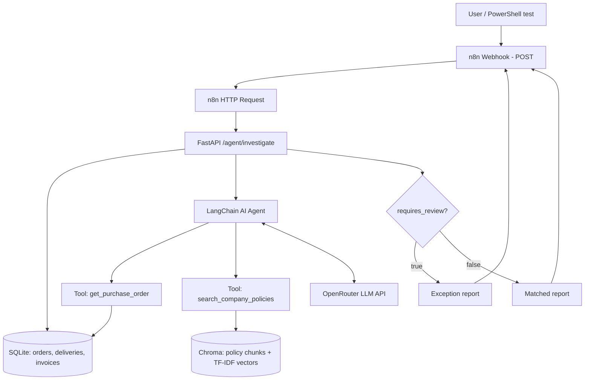
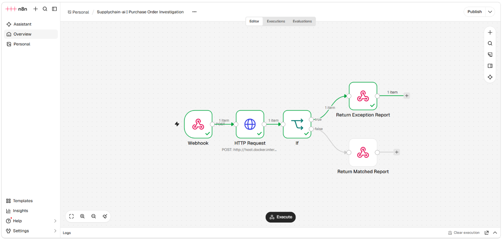

# Supplychain-ai

[](https://www.python.org/)
[](https://fastapi.tiangolo.com/)
[](https://python.langchain.com/)
[](https://n8n.io/)
[](https://www.docker.com/)
[](https://www.sqlite.org/)
[](https://openrouter.ai/)
[](https://ubuntu.com/)

**Supplychain-ai** is a portfolio MVP investigating discrepancies between purchase orders, deliveries, and invoices. It combines deterministic data checks with policy retrieval, an LLM agent using two read-only tools, n8n workflow automation, and a containerized FastAPI deployment on an Ubuntu VPS.

> **Scope and evidence:** Synthetic transactions and fictional company policies only. The VPS `POST /agent/investigate` test returned **HTTP 200**, used both tools and retrieved three policy filenames, but the generated explanation was **truncated mid-sentence**. This is a functional demonstration, **not** a production-ready financial decision system.

## Business problem

A company orders 500 units but records only 450 received, while an invoice bills 500. Without a shared investigation workflow, teams may need to reconcile these manually across purchasing, inventory, and accounts payable. Supplychain-ai detects the mismatch and assembles a policy-informed investigation for **human review**.

## System architecture



**Production boundary:** the Ubuntu container binds to `127.0.0.1:8000`; it is accessed on the VPS locally or from Windows through an SSH tunnel. The previously demonstrated n8n container is **local on Windows**, calling local FastAPI through `host.docker.internal:8000`. The n8n screenshot does **not** demonstrate a remotely hosted n8n service.

## Verified results

| Check | Evidence / outcome |
|---|---|
| VPS Docker | `supplychain-api` reported `healthy` |
| VPS database | Bootstrap skipped re-import for existing orders; persisted `/app/storage/supplychain.db` |
| VPS `/investigate` | HTTP 200; PO-104: 500 ordered, 450 received, 500 invoiced |
| Provisional exposure | 50 × $20 = **$1,000**; not confirmed loss |
| VPS `/agent/investigate` | HTTP 200, `agent_completed: true` |
| Tool execution | `get_purchase_order` and `search_company_policies` both reported |
| Retrieved policies | `invoice_policy.txt`, `receiving_policy.txt`, `supplier_escalation.txt` |
| n8n | Successful exception branch in provided workflow screenshot |
| Remaining problem | Agent narrative was truncated before completion; free LLM route has shown intermittent 502 errors |



The [sanitized workflow export](workflows/supplychain_n8n.json) is included. The [redacted result example](examples/po104_vps_result.json) records the observed output and its limitation. The synthetic policy corpus is instructional, not actual supplier contract authority.

## Core technologies and concepts

| Technology | Role |
|---|---|
| Python, FastAPI | Validation and API endpoints |
| SQLite | Relational data ingestion and joins |
| n8n | Webhook trigger, HTTP request, IF routing, response |
| OpenRouter | Hosted LLM inference |
| LangChain agents | Model-directed, read-only tool calls |
| LangChain + Chroma | Policy document storage and retrieval |
| scikit-learn TF-IDF | Lightweight **lexical** vectors, not semantic pretrained embeddings |
| Docker Compose | Packaging, restart behavior, health checks and persistent volume |
| Ubuntu VPS | Private cloud deployment |

## API surface

| Endpoint | Description |
|---|---|
| `GET /health` | Liveness response |
| `POST /investigate` | Verified arithmetic and discrepancy status |
| `POST /explain` | LLM explanation |
| `GET /rag/search?query=...` | Policy retrieval |
| `POST /rag/explain` | Policy-assisted LLM analysis |
| `POST /agent/investigate` | Agent calling purchase-order and policy tools |

**Example request**

```json
{"purchase_order_id":"PO-104"}
```

**Verified numerical outputs:** `delivery_shortfall: 50`, `invoice_difference: 50`, `financial_exposure: 1000.0`, `status: "EXCEPTION"`, `requires_review: true`.

## Run locally (Windows)

Prerequisites: Python 3.11+, VS Code, Docker Desktop. This repository documentation is intended to accompany the full application source (`app/`, `data/`, `tests/`, `Dockerfile`, `compose.yaml`, and `requirements.txt`) from your existing local project. **The downloadable portfolio package contains documentation, evidence, and workflow export; it does not contain your local application source.**

```powershell
cd G:\Project\SupplyChain-AI
py -m venv .venv
.\.venv\Scripts\python.exe -m pip install -r requirements.txt
.\.venv\Scripts\python.exe -m app.database
.\.venv\Scripts\python.exe -m pytest -v
.\.venv\Scripts\python.exe -m uvicorn app.main:app --host 0.0.0.0 --port 8000
```

Create a private `.env` from `.env.example` (if available) with `OPENROUTER_API_KEY`, `OPENROUTER_MODEL`, and `AGENT_MODEL`. **Never commit `.env`.**

Test the API at `http://127.0.0.1:8000/docs`. For n8n running in Docker on Windows, use `http://host.docker.internal:8000/agent/investigate` in its HTTP Request node. The sample webhook path is `/webhook-test/supplychain-investigate` when listening for a test event.

## Run with Docker / Ubuntu VPS

```bash
docker compose config --quiet
docker compose up -d --build
docker compose ps
curl -f http://127.0.0.1:8000/health
curl -sS -X POST http://127.0.0.1:8000/investigate \
  -H 'Content-Type: application/json' \
  -d '{"purchase_order_id":"PO-104"}'
```

The current Compose deployment intentionally exposes the API only on VPS loopback. From Windows, an SSH tunnel can forward local port 18000 to VPS port 8000:

```powershell
ssh -N -L 18000:127.0.0.1:8000 ubuntu@YOUR_VPS_IP
```

Use `http://127.0.0.1:18000/health` through that tunnel. Do not make this unauthenticated demo API publicly accessible.

## Tests and reliability

The project includes planned/API tests for health, discrepancy calculations, unknown orders, RAG retrieval, and mocked agent integration. **The user has not supplied a final Phase 5/6 Pytest run, so this README does not claim an observed test count.** Verify locally using `python -m pytest -v` and attach its actual output when available.

Known limitations: model provider availability and rate limits; responses truncated at generation budget; the demo has no public-user authentication, finance approval workflow, production observability or CI/CD. Tool execution is verified, but `agent_completed: true` does **not** validate that its written report is complete. Recommendations require human review. In particular, AI should not automatically hold a payment or adjust stock.

## Demo video

A short screen recording is recommended. See [n8n video storyboard](docs/n8n-video-storyboard.md) for a 60–90 second recording plan. After publishing the video, add its link or a thumbnail here. No video file is included in this package.

## Project documentation

- [n8n demonstration storyboard](docs/n8n-video-storyboard.md)
- [n8n workflow export](workflows/supplychain_n8n.json)
- [Observed VPS API example](examples/po104_vps_result.json)
- [n8n workflow screenshot](docs/images/n8n-workflow-success.png)

## Professional framing

This project demonstrates how **AI engineering** (RAG and agents), **data engineering** (validated relational data and calculations), and **cloud engineering** (container packaging, persistence, health checks, private VPS deployment) combine in an end-to-end operational prototype.
